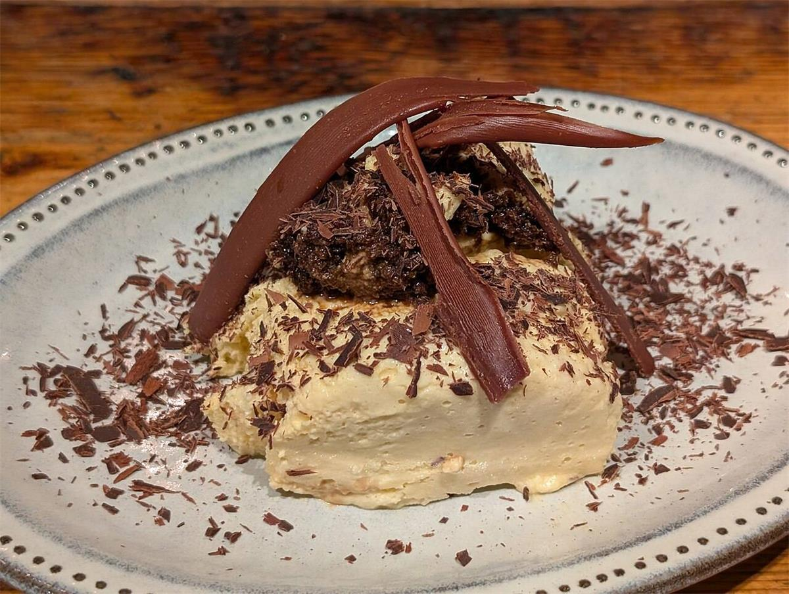

# MELLOW BEAN 사이트 가이드

이 문서는 디자인 회의(2026-11-25)와 그 과정에서 확인된 규칙을 정리한 것이다. 사이트를 만들거나 수정할 때 **이 문서에 적힌 것만** 사용하고, 적혀 있지 않은 장식·색·글꼴을 임의로 추가하지 않는다.

## 0. 가장 중요한 원칙: 출처 없는 선택은 하지 않는다

회의에서 사용자는 일반적인 카페 디자인 제안(크림·캐러멜 색, 세리프 제목, 손글씨 웹폰트 등)을 **"어디서 본 듯한 AI스러운 디자인"** 이라며 모두 거절했다. 그래서 모든 디자인 결정은 아래 둘 중 하나에서 나와야 한다.

1. **우리 자료**: `images/` 폴더의 실제 사진 (색은 사진에서 픽셀을 직접 추출)
2. **회의 결정**: 이 문서의 12장 결정 기록

"카페니까 보통 이렇게 한다"는 이유로 고른 것은 쓰지 않는다. 새 요소가 필요하면 먼저 위 두 출처에서 근거를 찾고, 없으면 사용자에게 질문한다.

## 1. 핵심 목표

방문자가 사이트를 보고 **"여기 커피 진짜 잘하겠다"** 고 느끼게 한다.

- 이 인상은 꾸밈이 아니라 **사실(원두 산지, 로스팅 날짜, 추출 수치)** 로 만든다.
- 자랑하는 문구는 쓰지 않는다. 정보를 담담하게 보여주면 전문성은 저절로 드러난다.

## 2. 절대 쓰지 말 것 (AI가 만든 티가 나는 요소)

| 구분 | 금지 |
|---|---|
| 색 | **브라운 계열 전부**(나무색, 원두색, 크레마 금색, 진한 베이지·크림 바탕 포함. 아주 옅은 아이보리 `--paper`만 예외), 세이지, 올리브, 테라코타, 번트오렌지, 머스타드, 그라데이션, 사진에서 추출하지 않은 모든 색 |
| 레이아웃 | 화면을 꽉 채우는 큰 사진, 섹션마다 배경색 번갈아 칠하기 |
| 글꼴 | Playfair Display, Fraunces, Montserrat, Pretendard, Inter, Poppins, Space Grotesk, 영문 손글씨 웹폰트(Caveat 등) |
| 장식 | 둥근 모서리 카드, 그림자 카드, 스르륵 나타나는(fade-in) 효과, `01 / 02` 장식 번호, 이모지, 아이콘 남발 |
| 문구 | "천천히, 따뜻하게", "당신만을 위한", "특별한 한 잔", "최고의 원두", 감성 형용사 나열 |
| 컨셉 | 70년대 레트로, 커피 매거진, 플랜테리어 같은 "○○ 스타일" 이름표 붙이기 |

## 3. 색 (모두 우리 사진에서 직접 추출)

| 이름 | 값 | 출처 | 용도 |
|---|---|---|---|
| 이름 | 값 | 출처 | 바탕 대비 | 용도 |
|---|---|---|---|---|
| `--paper` | `#F6F3E9` | `cafe-interior.jpg` 밝은 벽·천장 아이보리 | — | **페이지 전체 바탕** (유일한 배경색) |
| `--napkin` | `#232B30` | `cafe-latte.jpg` 검은 냅킨 | 13.0:1 | 제목, 본문, 로고 |
| `--table` | `#4C4D4A` | `latte-with-cookie.jpg` 회색 테이블 | 7.7:1 | 보조 글씨 (설명, 소개 문단, 바닥글) |
| `--wall` | `#C4C8CB` | `cafe-interior.jpg` 벽 회색 | 선 전용 | 1px 구분선만. **글씨에 쓰지 않는다** |
| `--straw` | `#2A6BAF` | `lemon-ade.jpg` 줄무늬 빨대 파랑 | 4.95:1 | 포인트: 가격, 라벨(산지·COFFEE 등), 링크 밑줄. 조금만 쓴다 |
| `--chair` | `#DB3A42` | `cafe-interior.jpg` 빨간 의자 | 선 전용 | **지도 위치 표시 원에만** 쓴다. 다른 곳에 쓰지 않는다 |

```css
:root {
  --paper:  #F6F3E9;
  --napkin: #232B30;
  --table:  #4C4D4A;
  --wall:   #C4C8CB;
  --straw:  #2A6BAF;
  --chair:  #DB3A42;
}
```

규칙:
- 이 여섯 가지 외의 색은 쓰지 않는다.
- 빨강은 처음에 딸기(`strawberry-latte.jpg`)에서 뽑으려 했지만, 사진 속 딸기는 그늘져서 가장 밝은 부분도 `#A93F2D`(벽돌색)였다. 갈색처럼 보일 수 있어서 매장 사진의 빨간 의자 색을 썼다. 투명도(`rgba`)로 변형하는 것도 하지 않는다.
- 배경은 `--paper` 하나뿐이다. 섹션은 배경색이 아니라 **여백**으로 구분한다.
- 바탕은 사용자 요청으로 흰색에서 **아이보리**로 바꿨다. 사진 속 밝은 부분(R 240~252, 따뜻한 기운 R-B 8~22) 픽셀을 모아 평균 낸 값이다. 처음 뽑은 티라미수 크림·매장 벽 평균은 그늘 때문에 너무 어두워서(`#D5D3CF` 등) 파란 글씨가 3.7:1밖에 안 나와 쓰지 않았다.
- 아이보리는 허용하지만 그보다 진한 베이지·크림(`#E9DEBE` 같은)은 여전히 금지다. 바탕이 진해질수록 파란 글씨가 4.5:1 아래로 떨어진다.
- 글씨 색은 바탕 대비 **4.5:1 이상**이어야 한다. 사진에서 뽑은 색이 기준에 못 미치면, 같은 물체의 더 진한(그늘진) 부분에서 다시 뽑는다. (회의에서 고른 매장 기둥 파랑 `#6B95B9`, 콘크리트 회색 `#8A908C`는 3.2:1이라 이 방법으로 `--straw`, `--table`로 바꿨다.)
- 색을 추가해야 하면 눈대중으로 정하지 말고 사진의 특정 영역 픽셀 평균을 추출해서 정한다 (14장 참고).

## 4. 글씨

### 로고
- 파일: `images/logo.svg`. 손으로 그린 듯한 선을 SVG 경로로 직접 그렸다 (폰트 아님).
- 선 색이 `currentColor`이므로 **``가 아니라 HTML 안에 SVG 코드를 직접 넣는다.** 그래야 부모의 `color`를 따라 배경에 맞게 색이 바뀐다.
- 로고 외의 곳에 손글씨 느낌을 흉내 내지 않는다.
- 사용자가 실제 손글씨 사진을 주면 그것으로 교체한다.

### 나머지 모든 글씨: IBM Plex Sans KR
```html
<link href="https://fonts.googleapis.com/css2?family=IBM+Plex+Sans+KR:wght@300;400;600&display=swap" rel="stylesheet">
```
- 글꼴은 이것 하나만 쓴다. 제목과 본문의 차이는 **굵기와 크기**로만 만든다.

| 역할 | 크기 | 굵기 | 비고 |
|---|---|---|---|
| 섹션 제목 | 32px (모바일 26px) | 600 | |
| 메뉴 이름 | 22px | 600 | |
| 본문 | 16px | 400 | 줄 간격 1.7 |
| 라벨·수치 (산지, 18g, 93℃) | 13px | 400 | 대문자 영문은 `letter-spacing: 0.08em` |
| 가격 | 18px | 300 | 숫자만, "원" 생략 (예: `5.0`) |

## 5. 페이지 구성 (위에서 아래 순서)

| # | 섹션 | 사진 | 내용 |
|---|---|---|---|
| 1 | 첫 화면 | `cafe-interior.jpg` **콘텐츠 너비 가득**, 높이 `clamp(240px, 62svh, 620px)` | 사진 **안** 왼쪽 아래 모서리의 흰 칸에 사실 한 줄: "매일 아침 직접 볶은 원두를 손으로 내립니다." PC 한 줄, 태블릿 두 줄, 휴대폰 세 줄 |
| 2 | 이번 주 원두 | 없음 | 원두 2종의 산지·가공·로스팅 날짜·맛 특징. 표 형태 |
| 3 | 추출 방식 | 없음 | 핸드드립 레시피를 수치로: 원두 18g · 물 93℃ 270ml · 2분 30초 |
| 4 | 메뉴 | 메뉴 사진 6장 | 사진 + 이름 + 가격 + 한 줄 설명 |
| 5 | 가게 이야기 | `hand-drip-coffee.jpg` | 매장에서 직접 로스팅한다는 사실과 짧은 소개 (매장 사진을 첫 화면으로 옮기면서 사진을 바꿨다. 메뉴의 핸드드립과 같은 사진) |
| 6 | 위치 | `cafe-map.jpg` | 페이지 맨 아래. 지도 위 카페 자리에 `--chair` 빨간 원 표시 + 주소·영업시간·전화·인스타그램. PC는 왼쪽 지도 / 오른쪽 정보, 좁은 화면은 지도 아래 정보 |
| — | 바닥글 | 없음 | "© 2026 MELLOW BEAN · 연습용 사이트입니다." |

- 상단 메뉴바는 `--paper` 바탕에 로고 + 섹션 링크(원두 · 메뉴 · 이야기 · 위치)만 둔다. 모바일(375px)에서 **한 줄**에 들어가야 한다 (로고 124px, 링크 간격 16px).
- **상단 메뉴바는 스크롤해도 화면 위에 고정**한다 (`position: sticky; top: 0`). 아래에 `--wall` 1px 선을 긋는다. 링크로 이동할 때 제목이 메뉴바에 가리지 않도록 `scroll-padding-top`을 메뉴바 높이만큼 준다.
- 별도의 '찾아오기' 섹션은 만들지 않는다. 주소·영업시간·연락처는 맨 아래 '위치' 섹션 안에서 지도와 함께 보여 준다. (한 번 삭제했다가 사용자 요청으로 '위치' 안에 다시 넣었다.)

### 지도 위치 표시
- 빨간 원은 이미지에 그려 넣지 않고, 지도와 같은 비율(676×671)의 SVG를 지도 위에 겹쳐 그린다. 화면 크기가 바뀌어도 원이 같은 자리에 있고, 원본 지도는 그대로 둘 수 있다.
- 원 위치는 지도 이미지 좌표 기준 `cx="312" cy="283" r="68"` (핀과 상호명 라벨을 함께 감쌈). 선 두께 5, 채우기 없음.
- 지도 이미지를 바꾸면 핀 위치를 다시 찾아 `cx`, `cy`를 고친다 (빨간 핀 픽셀 `R>220, G<110, B<90`의 범위로 찾았다).
- 지도는 원본 크기(676px)보다 크게 늘리지 않는다 (`max-width: 676px`). 늘리면 지도 글자가 흐려진다.

### 여백의 미
사용자는 "메인 이미지가 너무 크다, 여백의 미가 필요하다"고 했다.
- 사진이 브라우저 화면 끝까지 꽉 채우지 않게 한다. 첫 화면 사진은 **콘텐츠 너비(최대 1040px) 안에서** 가득 채우고, 좌우와 위아래에는 여백을 남긴다. (절반 크기로 줄였을 때 사용자가 "너무 작다"고 해서 이 크기로 정했다.)
- 콘텐츠 최대 너비 1040px. 여백은 고정값이 아니라 화면 폭에 따라 바뀐다 (15장 반응형):
  - 좌우 여백 `clamp(20px, 5vw, 48px)`
  - 섹션 사이 `clamp(96px, 14vw, 176px)`
  - 메뉴 사진 사이 가로 `clamp(24px, 4vw, 48px)` · 세로 `clamp(64px, 8vw, 96px)`
- 여백을 줄여서 내용을 더 넣고 싶어질 때는 내용을 빼는 쪽을 먼저 고려한다.

## 6. 메뉴 표현: 사진 + 이름 크게

- 사진은 **직각 모서리**, 같은 비율(4:5)로 잘라 맞춘다 (`aspect-ratio: 4/5; object-fit: cover;`).
- 사진 위쪽 라벨(분류, `--straw`), 그 아래 이름(22px/600)과 오른쪽 끝에 가격(`--straw`), 다음 줄에 한 줄 설명(13px, `--table`).
- 카드 테두리·그림자·배경 박스 없음. 사진과 글자만.
- 데스크톱 3열, 태블릿 2열, 모바일 1열.
- 커피 메뉴의 설명에는 맛 특징이나 사용 원두를 적는다.

## 7. 움직임: 스크롤 효과 조금

허용하는 것은 아래 두 가지뿐이다.
1. **메뉴 사진 확대:** 마우스를 올리면 사진이 1.04배로 천천히 커진다 (0.4s).
2. **링크 밑줄:** 마우스를 올리면 `--straw` 밑줄이 생긴다.

- 예전의 '첫 화면 사진 고정(sticky)'은 첫 화면 사진을 작게 바꾸면서 없앴다.

- `prefers-reduced-motion` 설정 시 모든 움직임을 끈다.
- 나타나기(fade-in), 튀어오르기, 자동 슬라이드는 쓰지 않는다.

## 8. 문구 톤

- 짧고 사실 위주로. 숫자와 고유명사를 쓴다.
- 좋은 예: "에티오피아 예가체프, 11월 24일 로스팅."
- 나쁜 예: "정성을 다해 특별한 한 잔을 내려드립니다."
- 문장 끝은 "~합니다" 체로 통일한다.
- 회의에서 사용자는 전문성 표현으로 '원두 정보·추출 과정·직접 로스팅'과 '따로 강조하지 않음'을 함께 골랐다. 이는 **"세 가지 내용을 다 넣되, 강조나 자랑 없이 사실로만"** 으로 해석해 적용한다.

## 9. 연습용 내용 (가짜 데이터)

실제 카페가 아니므로 아래 내용을 쓴다. **나중에 쉽게 바꿀 수 있도록 HTML 한 곳에 모아 둔다.**

### 이번 주 원두
| 이름 | 산지 | 가공 | 로스팅 | 맛 |
|---|---|---|---|---|
| 예가체프 | 에티오피아 | 워시드 | 11.24 · 약배전 | 자스민, 레몬, 홍차 |
| 우일라 | 콜롬비아 | 워시드 | 11.22 · 중배전 | 밀크초콜릿, 아몬드, 흑설탕 |

### 메뉴
| 분류 | 이름 | 가격 | 한 줄 설명 | 사진 |
|---|---|---|---|---|
| COFFEE | 핸드드립 | 6.0 | 이번 주 원두 중 선택 | `hand-drip-coffee.jpg` |
| COFFEE | 카페라떼 | 5.0 | 우일라 원두, 우유 200ml | `cafe-latte.jpg` |
| COFFEE | 라떼 & 쿠키 | 6.5 | 카페라떼와 초코칩 쿠키 | `latte-with-cookie.jpg` |
| NON-COFFEE | 딸기라떼 | 5.8 | 생딸기를 직접 갈아 넣습니다 | `strawberry-latte.jpg` |
| NON-COFFEE | 레몬에이드 | 5.5 | 레몬즙과 탄산수 | `lemon-ade.jpg` |
| DESSERT | 티라미수 | 6.5 | 에스프레소에 적신 사보이아르디 | `tiramisu.jpg` |

### 가게 이야기
"MELLOW BEAN은 매장 안쪽에서 원두를 직접 볶습니다. 볶은 지 2주가 지난 원두는 쓰지 않습니다. 매주 두 가지 원두를 골라 핸드드립과 라떼로 냅니다."

### 위치 정보
지도가 대구 반월당역 근처를 가리키므로 연습용 주소도 대구로 맞춘다 (처음의 '서울시 마포구'는 지도와 맞지 않아 바꿨다). 실제 건물 주소를 지어내지 않도록 도로명은 가짜 '연습로'를 쓴다.
- 주소: 대구광역시 중구 연습로 12, 1층 · 반월당역에서 걸어서 5분
- 영업시간: 화–일 09:00–19:00 · 월요일 휴무
- 전화: 053-000-0000
- 인스타그램: @mellowbean.practice (가짜 아이디라 실제 계정으로 연결되지 않게 링크를 걸지 않는다)

## 10. 파일 구조

```
index.html
css/style.css
js/main.js          (움직임 처리만, 필요할 때만)
images/             (웹용 이미지, 사이트는 여기만 참조)
images/originals/   (원본 보관, 사이트에서 참조하지 않음, 수정 금지)
images/logo.svg
skill.md            (이 문서)
```

## 11. 이미지 규칙

새 이미지를 추가할 때도 같은 방식으로 처리한다.

- **폴더·파일 이름은 영문 소문자 + 하이픈(kebab-case)**. 한글, 공백, 괄호, `IMG_0000`·`KakaoTalk_...` 같은 의미 없는 이름은 쓰지 않는다.
- 이름은 **사진을 직접 열어 내용을 확인한 뒤** 그 내용으로 짓는다 (예: `hand-drip-coffee.jpg`). 원래 파일명만 믿지 않는다. 원래 '딸기라떼'였던 사진은 밀크셰이크처럼 보였지만, 사용자가 붙인 이름을 존중해 `strawberry-latte`로 지었다. 이렇게 판단이 갈린 경우는 사용자에게 알린다.
- 원본은 같은 영문 이름으로 `images/originals/`에 옮기고 원래 확장자를 유지한다.
- 웹용은 **긴 변 최대 1200px, JPG, 품질 75**로 만든다. PNG 사진도 JPG로 바꾼다.
- 예외: **지도처럼 작은 글자가 많은 이미지는 품질 85**로 만든다. 75에서는 글자가 뭉개질 수 있다. (`cafe-map.png` 491KB → `cafe-map.jpg` 108KB)
- 변환 후 **웹용 용량이 원본보다 크지 않은지 반드시 비교**한다 (품질 82에서는 이미 압축된 원본보다 커지는 경우가 있었다).
- 변환 결과를 직접 열어 화질을 눈으로 확인한다.
- **사진마다 600px 폭의 작은 버전**(`이름-600.jpg`, 품질 75)을 함께 만든다. HTML에서 `srcset`으로 두 크기를 모두 알려 주면, 브라우저가 화면에 맞는 쪽을 골라 받는다 (휴대폰 데이터 절약, 사진당 약 1/3 용량).
  ```html
  
  ```
- 모든 ``에 실제 픽셀 크기 `width`, `height`를 적는다. 사진이 늦게 로딩돼도 자리가 미리 잡혀서 화면이 덜컹거리지 않는다.
- 지도(`cafe-map.jpg`)는 676px라 작은 버전을 만들지 않는다.

## 12. 회의 결정 기록 (2026-11-25)

| 질문 | 사용자 답 |
|---|---|
| 첫 방문자에게 듣고 싶은 말 | "여기 커피 진짜 잘하겠다" |
| 색의 출처 | 내 사진에서 뽑기 |
| 중심 색 | ~~테이블 나무 진갈색~~ → 이후 브라운 계열 삭제 요청으로 취소 (아래 표) |
| 로고 | 손글씨 로고 (제작은 Claude에게 맡김) |
| 본문 글씨 | 단정한 기계 느낌 (IBM Plex Sans KR) |
| 첫 화면 사진 | ~~핸드드립 추출~~ → 이후 요청으로 매장 내부(`cafe-interior.jpg`) |
| 전문성 표현 | 원두 정보, 추출 과정, 직접 로스팅 + 따로 강조하지 않음 (8장 해석 참고) |
| 꼭 들어갈 내용 | 메뉴와 가격, 가게 이야기, 매장 사진, 위치·영업시간·연락처 |
| 메뉴 모양 | 사진 + 이름 크게 |
| 움직임 | 스크롤 효과 조금 |
| 실제 내용 | 연습용 가짜 내용 |

### 첫 사이트를 본 뒤 수정 요청 (2026-11-25)

| 요청 | 반영 |
|---|---|
| "메인화면의 이미지가 너무 커요. 여백의 미가 필요해요" | 첫 화면 사진을 화면 가득 → 콘텐츠 절반 크기로. 전체 여백 확대 (5장 '여백의 미') |
| "찾아오기는 없어도 될 것 같아요" | 찾아오기 섹션과 메뉴 링크 삭제 |
| "브라운 계열 삭제해 주세요" | 나무 진갈색·베이지·크레마·원두색 모두 삭제. 중심 색 '테이블 나무 진갈색' 결정은 취소됨 |
| 새 색 조합 (선택형 질문) | "흰 바탕 + 회색 + 파랑 포인트" → 3장 |
| "상단 메뉴가 들어간 헤드 고정이 필요해요" | 상단 메뉴바를 화면 위에 고정 (5장) |
| "메인 이미지가 작아요. 이미지 안에 글 작성해 줘" | 첫 화면 사진을 콘텐츠 너비 가득으로 키우고, 문구를 사진 안으로 (5장, 15장) |
| 지도 이미지(`카페지도.png`) 추가, "빨간색 둥근 표시로 강조해서 페이지 맨 아래에" | `cafe-map.jpg`로 정리, 맨 아래 '위치' 섹션 + 빨간 원 + 메뉴 링크 '위치' 추가 (5장) |
| "PC, 모바일, 태블릿 등 다양한 환경에서 잘 구동되도록 반응형 최적화" | 15장 반응형 기준 전체 적용, 작은 사진 버전 추가 (11장) |
| "카페 메인화면을 cafe-interior로" | 첫 화면 사진을 매장 사진으로. 복잡한 사진이라 문구를 흰 모서리 칸에 넣음 (15장). 가게 이야기 사진은 핸드드립으로 |
| "마지막 위치 내용이 다시 들어가야 해요" | '위치' 섹션에 주소·영업시간·전화·인스타그램을 지도와 함께 다시 넣음. 주소는 지도에 맞춰 대구로 (9장) |
| "바탕은 흰색이 아니라 아이보리색으로" | `--paper`를 `#F6F3E9`(매장 사진의 밝은 벽)로 (3장) |

## 13. 사용자와 일하는 방식

- 사용자는 **웹페이지를 처음 만들고 디자인 지식이 없다.** 전문 용어는 풀어서 설명하고, 선택지마다 "이걸 고르면 어떻게 보이는지"를 함께 적는다.
- 결정이 필요하면 완성된 컨셉을 제안하기보다 **선택형 질문**으로 묻는다. 사용자는 "아이디어 3가지 추천"보다 질문으로 하나씩 정하는 방식을 원했다.
- 질문의 선택지도 2장의 금지 요소로 채우지 않는다. 선택지는 우리 사진·회의 결정에서 끌어낸다 (예: "사진 속 어떤 색을 쓸까요?").
- 사용자의 답이 서로 모순되면 임의로 하나를 버리지 말고, 양쪽을 살리는 해석을 정해 **그 해석을 사용자에게 알린다.**
- 만든 결과물(로고, 화면)은 직접 렌더링해 눈으로 확인한 뒤 보여준다.
- 커밋은 사용자가 요청할 때만 한다. 버전 규칙은 v1.01부터 0.01씩 올리고, 한국어 변경 메모와 태그를 붙인다.

## 14. 작업 환경 주의점 (이 컴퓨터: Windows 10, PowerShell 5.1)

- **Python이 설치되어 있지 않다.** 이미지 처리(크기 조절, 색 추출)는 PowerShell의 `System.Drawing`으로 한다.
- **한글이 들어간 `.ps1` 스크립트는 UTF-8 BOM으로 저장**해야 한다. BOM이 없으면 한글 경로가 깨져서 파일을 찾지 못한다.
- **PowerShell 변수는 대소문자를 구분하지 않는다.** `$b`와 `$B`는 같은 변수다. 색 추출 코드에서 이것 때문에 모든 값이 `#000000`으로 나온 적이 있다.
- 색 추출은 사진의 특정 영역(가로세로 약 24px)의 픽셀 평균으로 한다. 그림자가 진 부분은 피한다 (라떼 잔의 우유 부분은 그림자 때문에 푸른 회색으로 나와서 쓰지 않았다).
- 화면 확인은 Edge 헤드리스 스크린샷으로 한다:
  ```powershell
  & "${env:ProgramFiles(x86)}\Microsoft\Edge\Application\msedge.exe" --headless --disable-gpu --window-size=375,812 --screenshot="<저장경로>.png" "file:///<html경로>"
  ```
  15장의 확인용 화면 크기 7가지로 찍어 확인한다.
- **Edge 헤드리스는 창 너비에 최소값(약 500px)이 있어서** `--window-size=375,...`로 찍으면 실제로는 더 넓게 그려진 화면이 잘려서 나온다. 모바일은 375px 너비의 `<iframe>`에 페이지를 넣은 감싸는 HTML을 만들어 찍는다. 섹션별 확인은 주소 뒤에 `#menu`처럼 앵커를 붙인다.
- 임시 파일(테스트 HTML, 스크린샷)은 프로젝트 폴더가 아닌 임시 폴더에 둔다.

## 15. 기술 기준

- 모바일 화면을 먼저 만들고 넓은 화면으로 확장한다.
- 모든 ``에 한국어 `alt`를 넣는다 (예: "주전자로 핸드드립 커피를 내리는 모습").
- 첫 화면 사진은 `fetchpriority="high"`로 가장 먼저 받고, 나머지 이미지에는 `loading="lazy"`를 넣는다.
- 사진 위에 글씨를 올리는 곳은 **첫 화면 한 곳뿐**이다. 반투명 띠와 글자 번짐(text-shadow)은 쓰지 않는다.
  - 문구는 사진 **왼쪽 아래 모서리에 `--paper` 불투명 흰 칸**을 만들어 넣는다. 사진 모서리가 파인 것처럼 보인다.
  - 이유: 매장 사진(`cafe-interior.jpg`)은 의자·식물·문틀로 복잡해서 사진 위에 바로 쓴 글씨가 읽히지 않았다. 흰 칸은 어떤 사진으로 바꿔도 항상 읽힌다.
- 외부 라이브러리(jQuery, Bootstrap, 애니메이션 라이브러리)는 쓰지 않는다.

### 반응형 기준
| 화면 | 폭 | 바뀌는 것 |
|---|---|---|
| 작은 휴대폰 | ~359px | 로고 100px, 메뉴 글씨 14px, 간격 11px (메뉴바 한 줄 유지) |
| 휴대폰 | 360~599px | 기본값. 메뉴 1열, 원두는 원두별 목록, 추출 수치 2칸, 첫 화면 문구 세 줄 |
| 태블릿 세로 | 600~719px | 메뉴 2열, 첫 화면 문구 두 줄 |
| 태블릿 | 720~959px | 원두 표, 추출 수치 4칸 |
| 태블릿 가로·PC | 960px~ | 메뉴 3열, 가게 이야기 2단, 첫 화면 문구 한 줄 |
| 가로로 돌린 휴대폰 | 높이 500px 이하 | 메뉴바 52px로 얇게, 첫 화면 사진 높이 70svh |

- 글씨 크기와 여백은 `clamp(최소, 화면 비례, 최대)`로 쓴다. 단계별로 뚝뚝 바뀌지 않고 화면 폭에 따라 부드럽게 바뀐다.
- 첫 화면 사진 높이는 `clamp(240px, 62svh, 620px)`. `svh`는 휴대폰 주소창이 나타나고 사라져도 흔들리지 않는 화면 높이 단위다. 오래된 브라우저를 위해 바로 앞 줄에 `vh` 값도 함께 적는다.
- 메뉴 링크는 위아래 `padding: 10px 0`으로 손가락 터치 영역을 넓힌다.
- 메뉴 사진 확대 효과는 `@media (hover: hover)` 안에만 둔다. 터치 기기에서는 작동하지 않는다.
- 확인용 화면 크기 7가지: 320×568, 375×812, 667×375(가로), 768×1024, 1024×768, 1440×900, 1920×1080

## 16. 완성 후 점검표

- [ ] 3장의 여섯 가지 색 외의 색이 쓰이지 않았는가
- [ ] IBM Plex Sans KR 외의 글꼴이 쓰이지 않았는가 (로고 SVG 제외)
- [ ] 2장의 금지 요소가 하나도 없는가
- [ ] 출처(사진 또는 회의 결정)가 없는 디자인 요소가 없는가
- [ ] 둥근 모서리, 그림자가 없는가
- [ ] 갈색·진한 베이지 계열 색이 하나도 없는가 (사진 속 색, 아이보리 `--paper` 제외)
- [ ] 글씨 색이 모두 `--paper` 바탕 대비 4.5:1 이상인가
- [ ] 사진이 화면을 꽉 채우지 않고 주변에 여백이 충분한가
- [ ] 스크롤해도 상단 메뉴바가 위에 붙어 있는가 (섹션 앵커로 스크린샷 확인)
- [ ] 첫 화면 사진 안 문구가 모바일·데스크톱 모두에서 읽히는가
- [ ] 지도 위 빨간 원이 모바일·데스크톱 모두에서 핀을 정확히 감싸는가
- [ ] 모바일에서 상단 메뉴바가 한 줄인가
- [ ] 모든 문구가 사실 위주인가
- [ ] 모바일(375px)에서 메뉴가 1열로 보이는가 (스크린샷으로 확인)
- [ ] 데스크톱(1280px)에서 메뉴가 3열로 보이는가 (스크린샷으로 확인)
- [ ] 15장의 확인용 화면 크기 7가지에서 모두 깨짐 없이 보이는가
- [ ] 가로로 돌린 휴대폰(667×375)에서 첫 화면 문구가 화면 안에 보이는가
- [ ] 모든 사진에 `srcset`, `width`, `height`가 있는가 (지도 제외 `srcset`)
- [ ] 움직임 줄이기 설정에서 모든 효과가 꺼지는가
- [ ] 이미지 경로가 모두 `images/`를 가리키고 `images/originals/`를 참조하지 않는가
